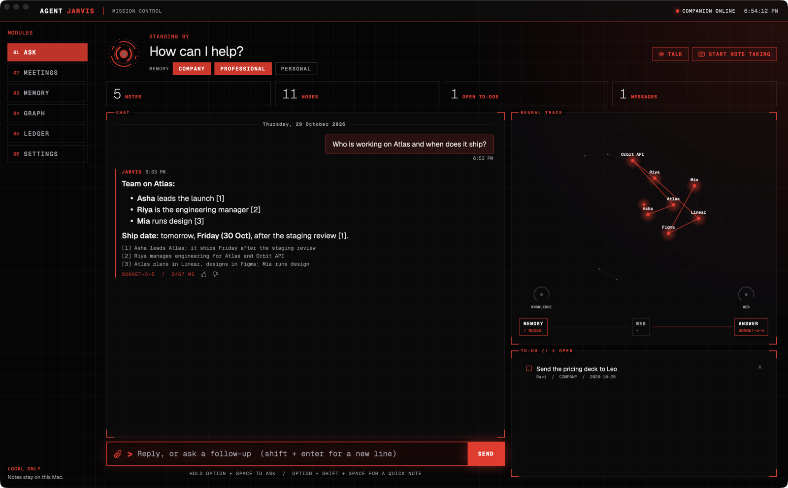
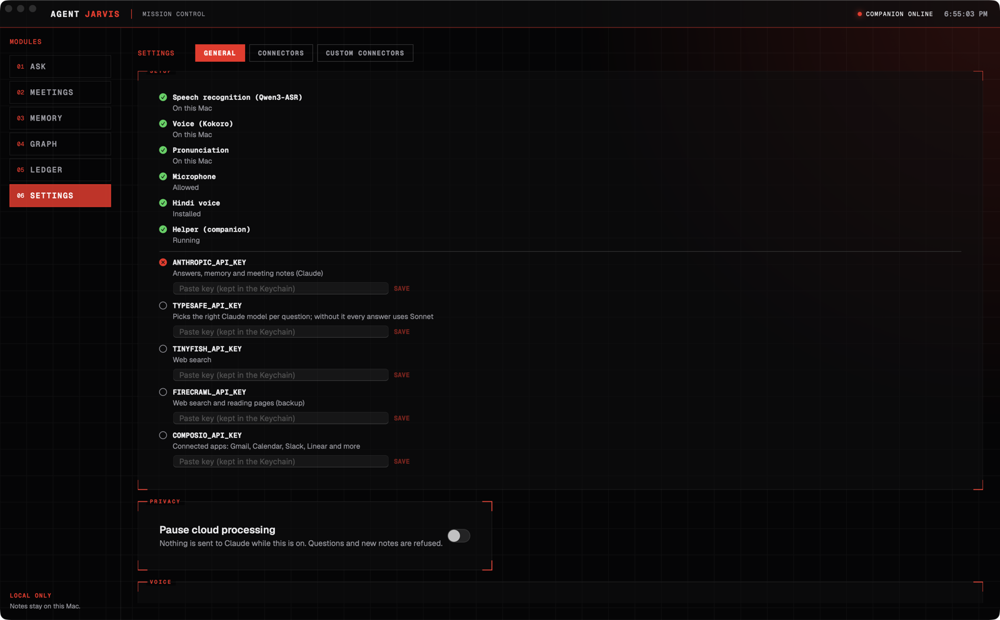

# Jarvis

A personal voice assistant for the Mac that remembers what you tell it. Say "Hey Jarvis" or hold Option + Space, ask a question, and it answers from your own notes, your meetings and the web, out loud.



- **Memory graph.** Notes become people, projects and tools linked together, kept in three spaces: company, professional and personal. Personal stays off until you turn it on.
- **Meeting notes.** Records your mic and the call's audio, transcribes on the Mac, and writes a summary with decisions and action items.
- **Voice in and out on the Mac.** Speech recognition (Qwen3-ASR) and the voice (Kokoro) run locally on Apple Silicon, and Smart Turn tells a finished sentence from a pause to think, so Jarvis answers quickly without cutting you off. Audio never leaves the Mac.
- **Tasks.** Reminders, to-dos, watches on your apps (Gmail, Calendar, Slack, Linear and more through Composio, or any MCP server), and its own headless browser.
- **Sandboxed.** The app has no network access at all. A small local helper (the companion) makes the API calls, and every call it makes is listed in the Ledger.

## How it fits together

| Part | What it is |
| --- | --- |
| `app/` | The SwiftUI app (Jarvis.app). App Sandbox, microphone only, no network. |
| `companion/` | A Node helper that runs in the background. It holds the memory (SQLite), calls Claude and other APIs, and talks to the app over a local socket. |
| `scripts/` | Build, sign and install scripts. |

## Requirements

- A Mac with Apple Silicon, macOS 14.2 or later
- Xcode (the full app, not only the command line tools: MLX needs its Metal shaders built)
- Node 22 or later
- Python 3 (for downloading the models)
- An [Anthropic API key](https://console.anthropic.com/). The other keys are optional.

Run `bash scripts/env-check.sh` to check all of these.

## Setup

1. **Get the code and the helper's packages.**

   ```sh
   git clone https://github.com/adarshmishra07/jarvis.git
   cd jarvis
   (cd companion && npm install)
   ```

2. **Download the speech models** (about 1 GB, once). The build copies them into the app, so the app itself never downloads anything. The small Smart Turn model (8 MB) is fetched by the build.

   ```sh
   pip3 install -U huggingface_hub
   hf download mlx-community/Qwen3-ASR-0.6B-8bit
   hf download mlx-community/Kokoro-82M-bf16
   ```

3. **Build and install.** This builds the app, signs it with the sandbox, checks it has no network entitlement, copies it to `/Applications/Jarvis.app`, installs the companion as a login item, and opens the app.

   ```sh
   bash scripts/install-app.sh
   ```

4. **Finish in Settings.** Open **Settings > General**. The Setup panel shows what is ready and what is missing. Paste your API keys there; they are saved in your login Keychain, never in a file.

   

   | Key | What it adds |
   | --- | --- |
   | `ANTHROPIC_API_KEY` | Required. Answers, memory and meeting notes. |
   | `TYPESAFE_API_KEY` | Picks the right Claude model per question. Without it every answer uses Sonnet. |
   | `TINYFISH_API_KEY` | Web search. |
   | `FIRECRAWL_API_KEY` | Web search and reading pages (backup). |
   | `COMPOSIO_API_KEY` | Connected apps: Gmail, Calendar, Slack, Linear and more. |

   If you prefer a file: put the keys in `.env` at the repo root (it is git-ignored) and run `bash scripts/keys-to-keychain.sh`.

5. **Allow the microphone** when macOS asks. For a clearer Hindi voice, install one in System Settings > Accessibility > Spoken Content.

6. **Optional: the browser.** For tasks that need a web page, install Playwright's Chromium once:

   ```sh
   (cd companion && npx playwright-core install chromium)
   ```

## Using it

- **Hold Option + Space** to ask by voice, or say **"Hey Jarvis"**. Option + Shift + Space saves a quick note.
- **Start note taking** in a call to get a transcript and summary in Meetings. "Hey Jarvis" is off while it takes notes.
- **Import** your existing notes (Markdown) from the Memory tab to build the graph.
- **Pause cloud processing** in Settings stops everything from being sent to Claude.

## Updating

Pull and run `bash scripts/install-app.sh` again. Your memory, chats and settings are kept outside the app, so updates never touch them. If only `companion/` changed, `bash scripts/install-launchagent.sh` updates the helper without restarting the app.

## Where your data lives

| What | Where |
| --- | --- |
| Memory, browser profile, backups | `~/Library/Application Support/agent-pikachu/` |
| Chats and meeting notes | The app's sandbox container (`~/Library/Containers/dev.agentpikachu.app/`) |
| API keys | Login Keychain, service `dev.agentpikachu` |
| Helper logs | `~/Library/Logs/agent-pikachu/companion.log` |

To remove the helper: `launchctl bootout gui/$(id -u)/dev.agentpikachu.companion && rm ~/Library/LaunchAgents/dev.agentpikachu.companion.plist`.

## Tests

```sh
(cd companion && npm test)
(cd app && swift test)
```
